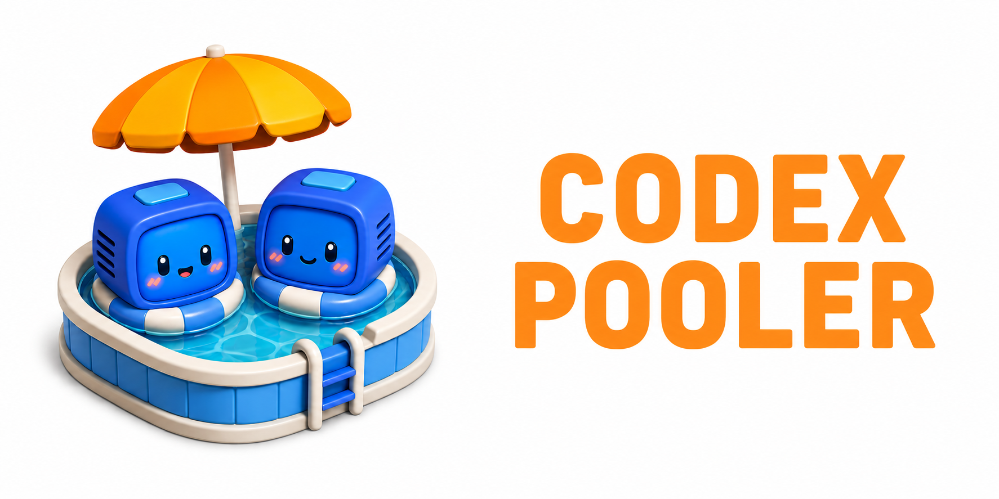
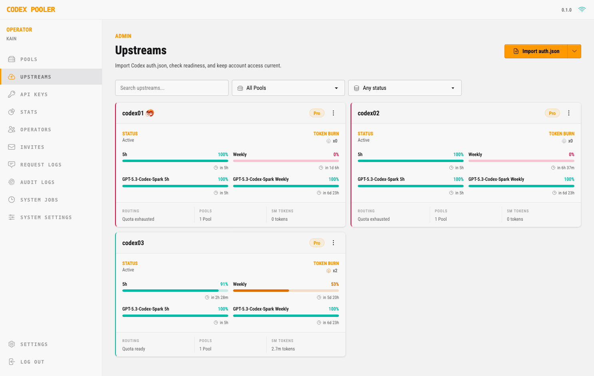
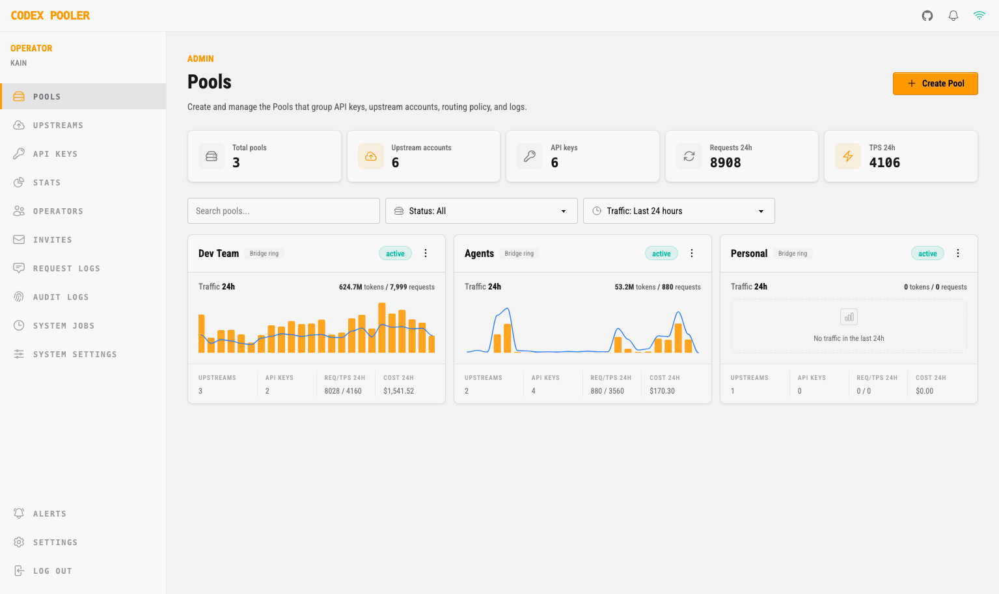
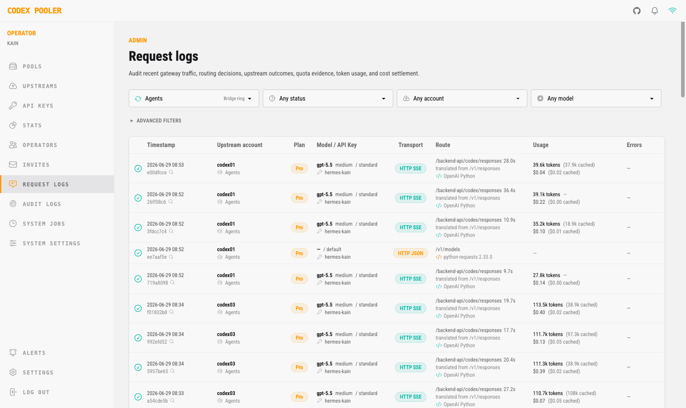
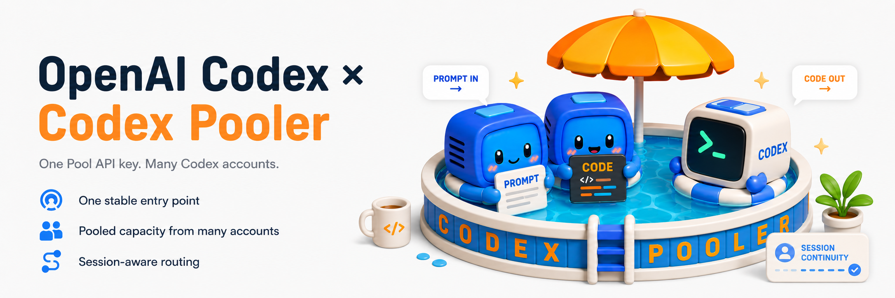
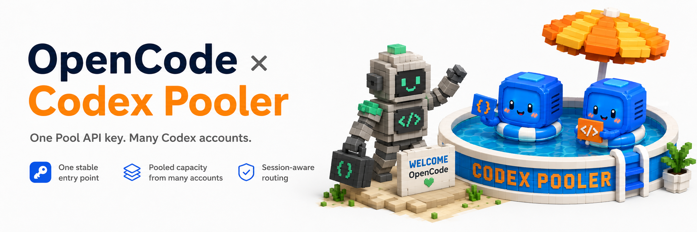
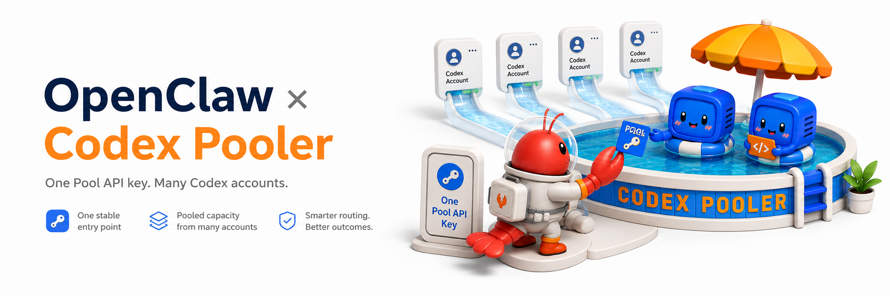
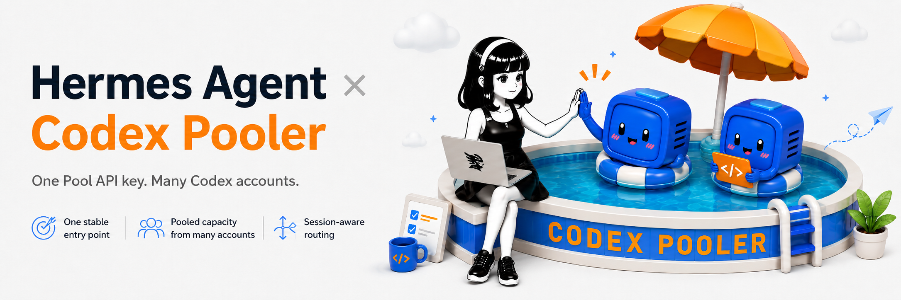
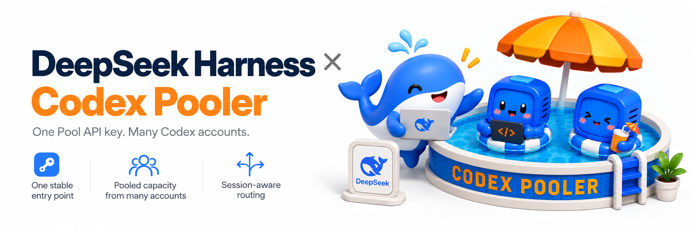
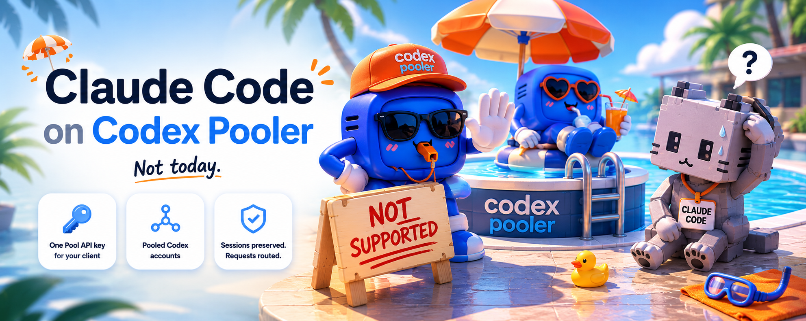

<h1 align="center">Codex Pooler</h1>

<p align="center">
  <strong>La pasarela Codex autohospedada y completa, para equipos, agentes y para ti. Compatible con:</strong><br>
  <br>
  <a href="#codex-setup" title="Codex CLI and Codex Desktop"></a>
  <a href="#opencode-setup" title="OpenCode"></a>
  <a href="#openclaw-setup" title="OpenClaw"></a>
  <a href="#hermes-setup" title="Hermes Agent"></a>
  <a href="#pi-setup" title="Pi"></a>
  <a href="#omp-setup" title="OMP"></a>
  <a href="#omo-native-setup" title="OMO Native"></a>
  <a href="#cursor-setup" title="Cursor"></a>
  <a href="#kilo-code-setup" title="Kilo Code"></a>
  <a href="#trae-setup" title="Trae"></a>
  <a href="#aider-setup" title="Aider"></a>
  <a href="#continue-setup" title="Continue"></a>
  <a href="#cline-setup" title="Cline"></a>
  <a href="#goose-setup" title="Goose"></a>
  <a href="#deepseek-harness-setup" title="DeepSeek Harness"></a>
  <a href="#windmill-setup" title="Windmill AI"></a>
  <a href="#home-assistant-setup" title="Home Assistant"></a>
  <a href="#openhands-setup" title="OpenHands"></a>
  <a href="#openai-python-sdk-setup" title="OpenAI-compatible SDKs"></a>
  <a href="#openai-node-sdk-setup" title="OpenAI-compatible SDKs"></a>
  <a href="#vercel-ai-sdk-setup" title="Vercel AI SDK"></a>
</p>

<p align="center">
  <a href="README.md">English</a>
  ·
  <a href="README.zh-CN.md">简体中文</a>
  ·
  <strong>Español</strong>
  ·
  <a href="README.ja.md">日本語</a>
</p>

<p align="center">
  <a href="https://www.codex-pooler.com">Sitio web</a>
  ·
  <a href="https://www.codex-pooler.com/docs/">Documentación</a>
  ·
  <a href="#quick-start-with-docker-compose">Inicio rápido</a>
  ·
  <a href="#harness-configuration">Clientes</a>
  ·
  <a href="#configuration">Configuración</a>
  ·
  <a href="#deployment">Despliegue</a>
  ·
  <a href="https://x.com/icoretech_inc">X</a>
  ·
  <a href="https://reddit.com/r/CodexPooler">Reddit</a>
</p>

<p align="center">
  <a href="https://trendshift.io/repositories/53664?utm_source=trendshift-badge&amp;utm_medium=badge&amp;utm_campaign=badge-trendshift-53664" target="_blank" rel="noopener noreferrer"></a>
</p>

<p align="center">
  
</p>

<table>
  <tr>
    <td align="center" valign="top" width="33%">
      <a href=".github/assets/screen1.png">
        
      </a><br>
      <sub>Cuentas proveedoras</sub>
    </td>
    <td align="center" valign="top" width="33%">
      <a href=".github/assets/screen2.png">
        
      </a><br>
      <sub>Pools</sub>
    </td>
    <td align="center" valign="top" width="33%">
      <a href=".github/assets/screen3.png">
        
      </a><br>
      <sub>Registros de solicitudes</sub>
    </td>
  </tr>
</table>

Codex Pooler es una pasarela autohospedada que permite ejecutar agentes,
herramientas y automatizaciones compatibles con Codex mediante claves API
estables de Pool. Funciona con una sola cuenta proveedora de Codex para aislar
credenciales, normalizar clientes, operar solo con metadatos y consultar los
restablecimientos guardados; añade más cuentas cuando quieras compartir
capacidad y distribuir solicitudes entre las cuentas aptas.

Los clientes envían las solicitudes habituales del backend de Codex o compatibles
con OpenAI; Codex Pooler selecciona una cuenta apta según los modelos admitidos,
los datos de cuota, los límites, la continuidad de la sesión, la política de
enrutamiento y el estado de la cuenta. La clave del Pool permanece estable aunque
cambien las asignaciones de cuentas proveedoras, su estado en el ciclo de vida,
la política de restablecimiento y la capacidad.

Los operadores disponen de un lugar centralizado para gestionar Pools, cuentas,
claves API, restablecimientos guardados, enrutamiento, contabilidad de solicitudes,
registros de auditoría y estado, sin almacenar prompts, archivos, audio, imágenes,
tokens bearer ni secretos de Codex en bruto. Los propietarios de la instancia
conservan el acceso a la administración global, mientras que los administradores
de la instancia trabajan solo con los Pools que tienen asignados.

<a id="highlights"></a>

## Características destacadas

- 🧩 **Usa las herramientas que ya conoces:** conecta Codex, OpenCode y otros
  agentes de programación compatibles, además de aplicaciones creadas con SDK compatibles con OpenAI
- 🔑 **Una clave para tus aplicaciones:** conecta herramientas con una clave API de Pool que
  se mantiene al añadir o sustituir cuentas de Codex, sin compartir las credenciales de las cuentas
- ⚡ **Alta reutilización de caché entre protocolos:** se ha observado más del 95 % de entrada en caché
  en HTTP/SSE y WebSockets, gracias al enrutamiento que tiene en cuenta la caché y a la reutilización de conexiones
- 🎯 **Selección automática de cuentas:** envía solicitudes a cuentas que puedan servir
  el modelo elegido, teniendo en cuenta la cuota disponible y el estado de la cuenta
- 📏 **Controla cuánto puede consumir cada clave:** establece límites de solicitudes
  y asignaciones diarias o semanales de uso de IA
- 🚀 **Da más margen de trabajo a los agentes:** permite que usen varias herramientas a la vez
  en modo Full, con compatibilidad Lite cuando sea necesaria
- 🖼️ **También imágenes y voz:** genera y edita imágenes o transcribe audio
  mediante aplicaciones compatibles, usando la misma clave API de Pool
- 🛡️ **Mantén privado el contenido de las conversaciones:** supervisa el uso y diagnostica solicitudes
  sin guardar prompts, respuestas, archivos subidos, imágenes ni audio
- 🔁 **Mantén la continuidad de las conversaciones:** conserva las sesiones compatibles vinculadas
  a la cuenta correcta cuando un cliente se reconecta
- 🔭 **Permite que los usuarios consulten su propio uso:** habilita un panel personal de Observatory
  para cada clave, con actividad, tiempos de respuesta y costos estimados
- 🏦 **Aprovecha los restablecimientos guardados:** consulta los créditos de restablecimiento disponibles
  y úsalos para recuperar la cuota de las cuentas, manualmente o de forma automática cuando esté habilitado
- 🖥️ **Gestiona todo desde un solo lugar:** añade cuentas, gestiona claves e invitaciones,
  consulta el uso y cambia ajustes desde el navegador
- 👥 **Organiza equipos y proyectos:** agrupa cuentas en Pools con sus propias
  reglas de acceso y selección de modelos
- 🤝 **Conecta cuentas por invitación:** permite que los propietarios de cuentas se unan a un Pool
  mediante un proceso guiado en el navegador, sin enviarte archivos de credenciales
- 🚨 **Detecta cuándo hace falta intervenir:** recibe alertas sobre capacidad reducida,
  problemas con cuentas y eventos de restablecimiento en el panel, por correo o mediante webhooks
- 🔎 **Detecta cambios a modelos inferiores:** consulta cuándo el proveedor
  informa de un modelo distinto del solicitado o cambia el nombre del modelo durante una respuesta
- 🧷 **Completa la continuidad que falta:** deriva identidades estables de sesión a partir de claves
  de caché o identificadores de conversación cuando el cliente no las envía directamente
- 🧱 **Elige quién puede conectarse:** permite, de forma opcional, solicitudes solo
  desde redes autorizadas
- 🐳 **Ejecútalo en tu propia infraestructura:** empieza con Docker Compose o despliega
  en Kubernetes a medida que crezcan tus necesidades

<a id="harness-configuration"></a>

## Configuración de clientes

Necesitas una instancia de Codex Pooler en funcionamiento, una clave API de Pool
y un cliente instalado. Los ejemplos incluyen `gpt-6-luna`, `gpt-6.1-sol` y
`gpt-6-astra`, con Sol seleccionado de forma predeterminada. Conserva los modelos
disponibles para tu Pool. Sustituye `<pool-api-key>` por tu clave y ejecuta el
comando correspondiente a tu terminal antes de iniciar el cliente.

**macOS / Linux / Windows WSL (bash o zsh)**

```bash
export CODEX_POOLER_API_KEY="<pool-api-key>"
```

**Windows PowerShell**

```powershell
$env:CODEX_POOLER_API_KEY = "<pool-api-key>"
```

Estos comandos establecen la clave para la terminal actual. Para aplicaciones
de escritorio, sigue la guía enlazada para guardar la clave para la aplicación.

Las rutas siguientes son las predeterminadas. En macOS/Linux, `~` es tu carpeta
personal. En Windows, pega las rutas que comienzan con `%USERPROFILE%`,
`%APPDATA%` o `%LOCALAPPDATA%` en la barra de direcciones del Explorador de
archivos. Si instalaste un cliente en WSL, usa sus rutas y comandos de Linux
dentro de WSL. Las carpetas de configuración o los perfiles personalizados
tienen prioridad sobre estos valores predeterminados.

Para una instancia local:

| Cliente | URL base |
| --- | --- |
| Codex CLI / Desktop | `http://localhost:4000/backend-api/codex` |
| Otros clientes y SDK | `http://localhost:4000/v1` |

Para una instancia desplegada, sustituye `http://localhost:4000` por el host de
tu instancia, como `https://codex-pooler.example.com`. Integra los fragmentos en
las configuraciones existentes. Los ejemplos usan el amplio **contexto de 828.400 tokens**
de GPT-6. Codex CLI y Desktop leen automáticamente el tamaño de contexto
disponible en tu Pool.

Cada entrada cubre la conexión básica. Su enlace de **configuración completa y opciones adicionales**
incluye la instalación, opciones avanzadas y resolución de problemas. El MCP para
operadores es opcional y usa un token independiente; consulta
[Servicio MCP para operadores](#operator-mcp-service).

<a id="codex-setup"></a>

<details>
<summary> Codex CLI y Codex Desktop <code>config.toml</code></summary>



| Sistema | Archivo de configuración |
| --- | --- |
| macOS / Linux | `~/.codex/config.toml` |
| Windows | `%USERPROFILE%\.codex\config.toml` |

Abre `config.toml` en la ruta correspondiente a tu sistema y añade lo siguiente.
Si has definido `CODEX_HOME`, usa el archivo de esa carpeta. Conserva
`name = "OpenAI"` para mantener las funciones nativas de Codex. El descubrimiento
del catálogo está habilitado por defecto; `model_catalog_url` lo dirige a tu Pool.

```toml
model = "gpt-6.1-sol"
model_provider = "codex-pooler-ws"

[model_providers.codex-pooler-ws]
name = "OpenAI"
base_url = "http://localhost:4000/backend-api/codex"
model_catalog_url = "http://localhost:4000/backend-api/codex/models"
env_key = "CODEX_POOLER_API_KEY"
wire_api = "responses"
supports_websockets = true
requires_openai_auth = true
```

Reinicia Codex y elige un modelo disponible para tu Pool.
Si usas Codex Desktop,
sigue la guía completa para que la aplicación pueda acceder a tu clave API.

**[Configuración completa y opciones adicionales](https://www.codex-pooler.com/docs/clients/codex-cli-desktop/)** — configuración de escritorio, ajustes de cuenta, conversaciones existentes y el nombre de proveedor personalizado opcional con sus limitaciones.

</details>

<a id="opencode-setup"></a>

<details>
<summary> OpenCode <code>opencode.jsonc</code></summary>



| Sistema | Archivo de configuración |
| --- | --- |
| macOS / Linux | `~/.config/opencode/opencode.jsonc` |
| Windows | `%USERPROFILE%\.config\opencode\opencode.jsonc` |

Abre `opencode.jsonc` en la ruta correspondiente a tu sistema y añade la
configuración de tu versión de OpenCode que aparece a continuación.

**OpenCode v2**

```jsonc
{
  "$schema": "https://opencode.ai/config.json",
  "model": "codex-pooler/gpt-6.1-sol",
  "agents": {
    "title": {
      "model": "codex-pooler/gpt-6-luna"
    }
  },
  "providers": {
    "codex-pooler": {
      "package": "@opencode/ai/providers/openai/responses",
      "settings": {
        "baseURL": "http://localhost:4000/v1",
        "apiKey": "{env:CODEX_POOLER_API_KEY}",
        "transport": "http",
        "compaction": {
          "type": "summary"
        }
      },
      "models": {
        "gpt-6-luna": {
          "modelID": "gpt-6-luna",
          "capabilities": {
            "tools": true,
            "input": ["text", "image"],
            "output": ["text"]
          },
          "limit": { "context": 828400, "input": 828400, "output": 32000 },
          "settings": {
            "reasoningEffort": "high",
            "reasoningSummary": "auto"
          }
        },
        "gpt-6.1-sol": {
          "modelID": "gpt-6.1-sol",
          "capabilities": {
            "tools": true,
            "input": ["text", "image"],
            "output": ["text"]
          },
          "limit": { "context": 828400, "input": 828400, "output": 32000 },
          "settings": {
            "reasoningEffort": "high",
            "reasoningSummary": "auto"
          }
        },
        "gpt-6-astra": {
          "modelID": "gpt-6-astra",
          "capabilities": {
            "tools": true,
            "input": ["text", "image"],
            "output": ["text"]
          },
          "limit": { "context": 828400, "input": 828400, "output": 32000 },
          "settings": {
            "reasoningEffort": "high",
            "reasoningSummary": "auto"
          }
        }
      }
    }
  }
}
```

**[Configuración completa y opciones adicionales de OpenCode v2](https://www.codex-pooler.com/docs/clients/opencode-v2/)** — instalación y opciones avanzadas.

**OpenCode v1**

```jsonc
{
  "$schema": "https://opencode.ai/config.json",
  "model": "openai/gpt-6.1-sol",
  "small_model": "openai/gpt-6-luna",
  "provider": {
    "openai": {
      "npm": "@ai-sdk/openai",
      "name": "Codex Pooler",
      "options": {
        "baseURL": "http://localhost:4000/v1",
        "apiKey": "{env:CODEX_POOLER_API_KEY}"
      },
      "models": {
        "gpt-6-luna": {
          "id": "gpt-6-luna",
          "name": "GPT-6 Luna",
          "family": "gpt",
          "attachment": true,
          "reasoning": true,
          "tool_call": true,
          "temperature": false,
          "options": {
            "reasoningEffort": "high",
            "reasoningSummary": "auto",
            "include": ["reasoning.encrypted_content"]
          },
          "modalities": {
            "input": ["text", "image"],
            "output": ["text"]
          },
          "limit": { "context": 828400, "input": 828400, "output": 64000 }
        },
        "gpt-6.1-sol": {
          "id": "gpt-6.1-sol",
          "name": "GPT-6.1 Sol",
          "family": "gpt",
          "attachment": true,
          "reasoning": true,
          "tool_call": true,
          "temperature": false,
          "options": {
            "reasoningEffort": "high",
            "reasoningSummary": "auto",
            "include": ["reasoning.encrypted_content"]
          },
          "modalities": {
            "input": ["text", "image"],
            "output": ["text"]
          },
          "limit": { "context": 828400, "input": 828400, "output": 64000 }
        },
        "gpt-6-astra": {
          "id": "gpt-6-astra",
          "name": "GPT-6 Astra",
          "family": "gpt",
          "attachment": true,
          "reasoning": true,
          "tool_call": true,
          "temperature": false,
          "options": {
            "reasoningEffort": "high",
            "reasoningSummary": "auto",
            "include": ["reasoning.encrypted_content"]
          },
          "modalities": {
            "input": ["text", "image"],
            "output": ["text"]
          },
          "limit": { "context": 828400, "input": 828400, "output": 64000 }
        }
      }
    }
  }
}
```

**[Configuración completa y opciones adicionales de OpenCode v1](https://www.codex-pooler.com/docs/clients/opencode/)** — instalación y configuración de OMO.

</details>

<a id="openclaw-setup"></a>

<details>
<summary> OpenClaw <code>openclaw.json</code></summary>



| Sistema | Archivo de configuración |
| --- | --- |
| macOS / Linux | `~/.openclaw/openclaw.json` |
| Windows | `%USERPROFILE%\.openclaw\openclaw.json` |

Abre `openclaw.json` en la ruta correspondiente a tu sistema y añade esta configuración:

```json5
{
  agents: {
    defaults: {
      model: {
        primary: "openai/gpt-6.1-sol",
        list: [{ id: "background", model: "openai/gpt-6-luna" }],
      },
      compaction: { reserveTokens: 128000 },
    },
  },
  models: {
    mode: "merge",
    providers: {
      openai: {
        baseUrl: "http://localhost:4000/v1",
        apiKey: "${CODEX_POOLER_API_KEY}",
        api: "openai-responses",
        agentRuntime: { id: "openclaw" },
        timeoutSeconds: 300,
        models: [
          {
            id: "gpt-6-luna",
            name: "GPT-6 Luna via Codex Pooler",
            reasoning: true,
            input: ["text", "image"],
            contextWindow: 828400,
            contextTokens: 828400,
            maxTokens: 128000,
          },
          {
            id: "gpt-6.1-sol",
            name: "GPT-6.1 Sol via Codex Pooler",
            reasoning: true,
            input: ["text", "image"],
            contextWindow: 828400,
            contextTokens: 828400,
            maxTokens: 128000,
          },
          {
            id: "gpt-6-astra",
            name: "GPT-6 Astra via Codex Pooler",
            reasoning: true,
            input: ["text", "image"],
            contextWindow: 828400,
            contextTokens: 828400,
            maxTokens: 128000,
          },
        ],
      },
    },
  },
}
```

Reinicia OpenClaw e inicia una conversación nueva.

**[Configuración completa y opciones adicionales](https://www.codex-pooler.com/docs/clients/openclaw/)** — tareas en segundo plano, más modelos y opciones avanzadas.

</details>

<a id="hermes-setup"></a>

<details>
<summary> Hermes Agent <code>config.yaml</code></summary>



| Sistema | Carpeta de `.env` y `config.yaml` |
| --- | --- |
| macOS / Linux | `~/.hermes/` |
| Windows | `%LOCALAPPDATA%\hermes\` |

Abre `.env` en la carpeta correspondiente a tu sistema y añade tu clave API de
Pool y la dirección de Codex Pooler. Si has definido `HERMES_HOME`, usa esa carpeta:

```dotenv
OPENAI_API_KEY=<pool-api-key>
OPENAI_BASE_URL=http://localhost:4000/v1
STT_OPENAI_BASE_URL=http://localhost:4000/v1
```

Añade esto a `config.yaml` en la misma carpeta y reinicia Hermes:

```yaml
model:
  default: gpt-6.1-sol
  provider: openai-api
  base_url: http://localhost:4000/v1
  api_mode: codex_responses
  context_length: 828400
  supports_vision: true

agent:
  image_input_mode: native
  api_max_retries: 2
  auto_recovery_cycles: 1

image_gen:
  provider: openai
  openai:
    model: gpt-image-2.6-flare

stt:
  enabled: true
  provider: openai
  openai:
    model: gpt-4o-transcribe

compression:
  threshold: 0.95

auxiliary:
  compression:
    timeout: 900
```

Esta configuración incluye generación de imágenes y transcripción de voz a texto.
Para cambiar el modelo de chat, asigna a `model.default` un modelo disponible
para tu Pool. Mantén las tres direcciones apuntando a tu instancia de Codex Pooler.
Tu Pool también debe ofrecer los modelos de imagen y transcripción para usar esas funciones.

**[Configuración completa y opciones adicionales](https://www.codex-pooler.com/docs/clients/hermes/)** — imágenes, transcripción de voz a texto, procesamiento prioritario y resolución de problemas.

</details>

<a id="pi-setup"></a>

<details>
<summary> Pi <code>models.json</code></summary>


| Sistema | Archivo de configuración |
| --- | --- |
| macOS / Linux | `~/.pi/agent/models.json` |
| Windows | `%USERPROFILE%\.pi\agent\models.json` |

Abre `models.json` en la ruta correspondiente a tu sistema y añade esta configuración:

```json
{
  "providers": {
    "codex-pooler": {
      "name": "Codex Pooler",
      "baseUrl": "http://localhost:4000/v1",
      "api": "openai-responses",
      "apiKey": "$CODEX_POOLER_API_KEY",
      "authHeader": true,
      "models": [
        {
          "id": "gpt-6-luna",
          "name": "GPT-6 Luna via Codex Pooler",
          "reasoning": true,
          "input": ["text", "image"],
          "contextWindow": 828400,
          "maxTokens": 128000,
          "thinkingLevelMap": { "xhigh": "xhigh" }
        },
        {
          "id": "gpt-6.1-sol",
          "name": "GPT-6.1 Sol via Codex Pooler",
          "reasoning": true,
          "input": ["text", "image"],
          "contextWindow": 828400,
          "maxTokens": 128000,
          "thinkingLevelMap": { "xhigh": "xhigh" }
        },
        {
          "id": "gpt-6-astra",
          "name": "GPT-6 Astra via Codex Pooler",
          "reasoning": true,
          "input": ["text", "image"],
          "contextWindow": 828400,
          "maxTokens": 128000,
          "thinkingLevelMap": { "xhigh": "xhigh" }
        }
      ]
    }
  }
}
```

Añade estos valores predeterminados a `settings.json` en la misma carpeta:

```json
{
  "defaultProvider": "codex-pooler",
  "defaultModel": "gpt-6.1-sol",
  "enabledModels": [
    "codex-pooler/gpt-6-luna",
    "codex-pooler/gpt-6.1-sol",
    "codex-pooler/gpt-6-astra"
  ],
  "compaction": { "reserveTokens": 128000 }
}
```

A continuación, inicia Pi:

```bash
pi
```

**[Configuración completa y opciones adicionales](https://www.codex-pooler.com/docs/clients/pi/)** — instalación, modelos predeterminados y opciones adicionales.

</details>

<a id="omp-setup"></a>

<details>
<summary> OMP <code>models.yml</code></summary>


| Sistema | Archivo de configuración |
| --- | --- |
| macOS / Linux | `~/.omp/agent/models.yml` |
| Windows | `%USERPROFILE%\.omp\agent\models.yml` |

Abre `models.yml` en la ruta correspondiente a tu sistema y añade esta configuración:

```yaml
providers:
  codex-pooler:
    baseUrl: http://localhost:4000/v1
    api: openai-responses
    apiKey: CODEX_POOLER_API_KEY
    authHeader: true
    remoteCompaction:
      enabled: true
      api: openai-codex-responses
      endpoint: http://localhost:4000/backend-api/codex/responses/compact
      v2StreamingEnabled: true
      v2Endpoint: http://localhost:4000/backend-api/codex/responses
    models:
      - id: gpt-6-luna
        name: GPT-6 Luna via Codex Pooler
        reasoning: true
        input: [text, image]
        compat:
          streamIdleTimeoutMs: 300000
        contextWindow: 828400
        maxTokens: 128000
      - id: gpt-6.1-sol
        name: GPT-6.1 Sol via Codex Pooler
        reasoning: true
        input: [text, image]
        compat:
          streamIdleTimeoutMs: 300000
        contextWindow: 828400
        maxTokens: 128000
      - id: gpt-6-astra
        name: GPT-6 Astra via Codex Pooler
        reasoning: true
        input: [text, image]
        compat:
          streamIdleTimeoutMs: 300000
        contextWindow: 828400
        maxTokens: 128000
```

Añade estos valores predeterminados a `config.yml` en la misma carpeta:

```yaml
startup:
  setupWizard: false
enabledModels:
  - codex-pooler/gpt-6-luna
  - codex-pooler/gpt-6.1-sol
  - codex-pooler/gpt-6-astra
modelProviderOrder:
  - codex-pooler
modelRoles:
  default: codex-pooler/gpt-6.1-sol:high
  smol: codex-pooler/gpt-6-luna:low
  tiny: codex-pooler/gpt-6-luna:minimal
  slow: codex-pooler/gpt-6-astra:xhigh
  plan: codex-pooler/gpt-6-astra:xhigh
  task: codex-pooler/gpt-6.1-sol:high
  vision: codex-pooler/gpt-6.1-sol:high
  advisor: codex-pooler/gpt-6.1-sol:medium
  commit: codex-pooler/gpt-6-luna:minimal
  designer: codex-pooler/gpt-6-astra:high
compaction:
  enabled: true
  thresholdPercent: 80
  reserveTokens: 128000
  remoteStreamingV2Enabled: true
  midTurnEnabled: true
  handoffSaveToDisk: true
  methodOrder: [remote, soft]
```

El umbral del 80 % deja espacio para las instrucciones de compactación y los resultados recientes de las herramientas. Mantén `reserveTokens` ajustado al presupuesto de salida. Si una sesión existente ya está cerca de su límite, consulta las [notas de recuperación de la compactación](https://www.codex-pooler.com/docs/clients/omp/#troubleshooting).

A continuación, inicia OMP:

```bash
omp
```

**[Configuración completa y opciones adicionales](https://www.codex-pooler.com/docs/clients/omp/)** — instalación, selección de modelos y conversaciones largas.

</details>

<a id="omo-native-setup"></a>

<details>
<summary> OMO Native <code>models.json</code></summary>

Conecta el cliente independiente `omo` y su motor Senpi integrado a tu Pool.
Para OMO dentro de OpenCode, usa la [configuración de OpenCode](#opencode-setup).

| Sistema | Archivo de configuración |
| --- | --- |
| macOS / Linux | `~/.omo/agent/models.json` |
| Windows | `%USERPROFILE%\.omo\agent\models.json` |

Integra este proveedor en `models.json`, conservando los proveedores existentes:

```json
{
  "providers": {
    "codex-pooler": {
      "baseUrl": "https://codex-pooler.example.com/v1",
      "api": "openai-responses",
      "apiKey": "$CODEX_POOLER_API_KEY",
      "authHeader": true,
      "models": [
        { "id": "gpt-6.1-sol", "reasoning": true, "defaultThinkingLevel": "medium", "input": ["text"] },
        { "id": "gpt-6-luna", "reasoning": true, "defaultThinkingLevel": "low", "input": ["text"] },
        { "id": "gpt-6-astra", "reasoning": true, "defaultThinkingLevel": "high", "input": ["text"] }
      ]
    }
  }
}
```

Conserva el `$` en la referencia a la clave API y sustituye la URL de ejemplo por
la URL `/v1` de tu Pooler. Conserva solo los modelos disponibles para tu Pool. Empieza con Sol:

```bash
omo --provider codex-pooler --model gpt-6.1-sol --thinking medium
```

Esta configuración cubre las solicitudes de texto. La guía incluye valores
predeterminados guardados y una comprobación de conexión sin herramientas.

**[Configuración completa y opciones adicionales](https://www.codex-pooler.com/docs/clients/omo-native-senpi/)** — instalación, modelos predeterminados y comprobaciones de conexión.

</details>

<a id="cursor-setup"></a>

<details>
<summary> Cursor <code>Settings → Models → API Keys</code></summary>


En **Settings → Models → API Keys**, habilita **OpenAI API Key** y
**Override OpenAI Base URL**. Introduce tu clave API de Pool y una URL HTTPS
pública, como `https://codex-pooler.example.com/v1`, y selecciona un modelo
disponible para tu Pool.

BYOK en Cursor requiere **Pro o superior**. Las solicitudes pasan por los
servidores de Cursor, por lo que localhost y las URL de redes LAN privadas no
funcionan. Usa un modelo explícito en lugar del modo Auto.

**[Configuración completa y opciones adicionales](https://www.codex-pooler.com/docs/clients/cursor/)** — requisitos previos, selección de modelos y comprobaciones de conexión.

</details>

<a id="kilo-code-setup"></a>

<details>
<summary> Kilo Code <code>kilo.jsonc</code></summary>


| Sistema | Archivo de configuración |
| --- | --- |
| macOS / Linux | `~/.config/kilo/kilo.jsonc` |
| Windows | `%USERPROFILE%\.config\kilo\kilo.jsonc` |

Abre `kilo.jsonc` en la ruta correspondiente a tu sistema y añade esta configuración:

```jsonc
{
  "$schema": "https://app.kilo.ai/config.json",
  "model": "codex-pooler/gpt-6.1-sol",
  "enabled_providers": ["codex-pooler"],
  "provider": {
    "codex-pooler": {
      "options": {
        "apiKey": "{env:CODEX_POOLER_API_KEY}",
        "baseURL": "http://localhost:4000/v1"
      },
      "models": {
        "gpt-6-luna": {
          "name": "GPT-6 Luna via Codex Pooler",
          "tool_call": true,
          "reasoning": true,
          "temperature": false,
          "attachment": true,
          "modalities": {
            "input": ["text", "image"],
            "output": ["text"]
          },
          "limit": { "context": 828400, "input": 828400, "output": 64000 }
        },
        "gpt-6.1-sol": {
          "name": "GPT-6.1 Sol via Codex Pooler",
          "tool_call": true,
          "reasoning": true,
          "temperature": false,
          "attachment": true,
          "modalities": {
            "input": ["text", "image"],
            "output": ["text"]
          },
          "limit": { "context": 828400, "input": 828400, "output": 64000 }
        },
        "gpt-6-astra": {
          "name": "GPT-6 Astra via Codex Pooler",
          "tool_call": true,
          "reasoning": true,
          "temperature": false,
          "attachment": true,
          "modalities": {
            "input": ["text", "image"],
            "output": ["text"]
          },
          "limit": { "context": 828400, "input": 828400, "output": 64000 }
        }
      }
    }
  }
}
```

Reinicia Kilo y selecciona el modelo de Codex Pooler.

**[Configuración completa y opciones adicionales](https://www.codex-pooler.com/docs/clients/kilo-code/)** — instalación, selección de modelos y opciones adicionales.

</details>

<a id="trae-setup"></a>

<details>
<summary> Trae <code>Settings -> Models</code></summary>

Inicia sesión en Trae, abre **Settings → Models** y añade un modelo personalizado:

| Campo | Valor |
| --- | --- |
| Formato de API | OpenAI Chat Completions |
| URL de solicitud personalizada (Custom Request URL) | `http://localhost:4000/v1` |
| URL completa (Full URL) | Desactivada |
| ID del modelo (Model ID) | `gpt-6.1-sol` |
| Clave API | Tu clave API de Pool |
| Serie de modelos (Model Series) | Predeterminada (Default) |

Repite esta configuración con otro Model ID para añadir más modelos disponibles para tu Pool.

No añadas una barra al final de la URL. Guarda el modelo, desactiva **Auto Mode**
en el selector de modelos del agente y selecciónalo en **Custom Models**.

**[Configuración completa y opciones adicionales](https://www.codex-pooler.com/docs/clients/trae/)** — Trae CN, ajustes adicionales y comprobaciones de conexión.

</details>

<a id="aider-setup"></a>

<details>
<summary> Aider <code>.aider.conf.yml</code></summary>


| Sistema | Archivo de configuración |
| --- | --- |
| macOS / Linux | `~/.aider.conf.yml` |
| Windows | `%USERPROFILE%\.aider.conf.yml` |

Abre `.aider.conf.yml` en la ruta correspondiente a tu sistema y añade estos ajustes:

```yaml
model: openai/gpt-6.1-sol
openai-api-base: http://localhost:4000/v1
```

Mantén la clave API de Pool en el entorno e inicia Aider desde tu repositorio:

**macOS / Linux / WSL**

```bash
export OPENAI_API_KEY="$CODEX_POOLER_API_KEY"
aider
```

**Windows PowerShell**

```powershell
$env:OPENAI_API_KEY = $env:CODEX_POOLER_API_KEY
aider
```

Si Aider no reconoce el modelo, sigue los pasos adicionales de configuración
de la guía completa.

Para cambiar de modelo, asigna a `model` un modelo disponible para tu Pool,
conservando el prefijo `openai/`.

**[Configuración completa y opciones adicionales](https://www.codex-pooler.com/docs/clients/aider/)** — configuración adicional de modelos y edición de archivos.

</details>

<a id="continue-setup"></a>

<details>
<summary> Continue <code>config.yaml</code></summary>


| Sistema | Archivo de configuración |
| --- | --- |
| macOS / Linux | `~/.continue/config.yaml` |
| Windows | `%USERPROFILE%\.continue\config.yaml` |

Guarda tu clave API de Pool en Continue como `CODEX_POOLER_API_KEY` siguiendo las
[instrucciones de configuración de secretos](https://www.codex-pooler.com/docs/clients/continue/).
Después, abre `config.yaml` en la ruta correspondiente a tu sistema y añade esta configuración:

```yaml
name: Codex Pooler
version: 1.0.0
schema: v1

models:
  - name: GPT-6 Luna via Codex Pooler
    provider: openai
    model: gpt-6-luna
    apiBase: http://localhost:4000/v1
    apiKey: "${{ secrets.CODEX_POOLER_API_KEY }}"
    contextLength: 828400
    defaultCompletionOptions:
      maxTokens: 128000
    roles: [chat, edit, apply, summarize]
    capabilities: [tool_use, image_input]
  - name: GPT-6.1 Sol via Codex Pooler
    provider: openai
    model: gpt-6.1-sol
    apiBase: http://localhost:4000/v1
    apiKey: "${{ secrets.CODEX_POOLER_API_KEY }}"
    contextLength: 828400
    defaultCompletionOptions:
      maxTokens: 128000
    roles: [chat, edit, apply, summarize]
    capabilities: [tool_use, image_input]
  - name: GPT-6 Astra via Codex Pooler
    provider: openai
    model: gpt-6-astra
    apiBase: http://localhost:4000/v1
    apiKey: "${{ secrets.CODEX_POOLER_API_KEY }}"
    contextLength: 828400
    defaultCompletionOptions:
      maxTokens: 128000
    roles: [chat, edit, apply, summarize]
    capabilities: [tool_use, image_input]
```

Selecciona esta configuración y el modelo de Codex Pooler en Continue.

**[Configuración completa y opciones adicionales](https://www.codex-pooler.com/docs/clients/continue/)** — almacenamiento de la clave API, ajustes adicionales y uso de la CLI.

</details>

<a id="cline-setup"></a>

<details>
<summary> Cline</summary>


Para Cline CLI, guarda los ajustes de conexión con:

**macOS / Linux / WSL**

```bash
cline auth \
  --provider openai \
  --apikey "$CODEX_POOLER_API_KEY" \
  --baseurl http://localhost:4000/v1 \
  --modelid gpt-6.1-sol
```

**Windows PowerShell**

```powershell
cline auth --provider openai --apikey "$env:CODEX_POOLER_API_KEY" --baseurl http://localhost:4000/v1 --modelid gpt-6.1-sol
```

Inicia Cline y usa el modelo guardado. En la extensión del IDE, elige
**OpenAI Compatible** e introduce la misma dirección, clave API y modelo.

Asigna a `--modelid` un modelo disponible para tu Pool.

**[Configuración completa y opciones adicionales](https://www.codex-pooler.com/docs/clients/cline/)** — configuración del IDE, ajustes adicionales y comprobaciones de conexión.

</details>

<a id="goose-setup"></a>

<details>
<summary> Goose <code>config.yaml</code></summary>


| Sistema | Archivo de configuración |
| --- | --- |
| macOS / Linux | `~/.config/goose/config.yaml` |
| Windows | `%APPDATA%\Block\goose\config\config.yaml` |

Abre `config.yaml` en la ruta correspondiente a tu sistema y añade esta configuración:

```yaml
GOOSE_PROVIDER: openai
GOOSE_MODEL: gpt-6.1-sol
OPENAI_HOST: http://localhost:4000
OPENAI_BASE_PATH: v1/chat/completions
GOOSE_CONTEXT_LIMIT: 828400
GOOSE_MAX_TOKENS: 128000
```

Ejecuta esto en tu terminal antes de iniciar Goose:

**macOS / Linux / WSL**

```bash
export OPENAI_API_KEY="$CODEX_POOLER_API_KEY"
```

**Windows PowerShell**

```powershell
$env:OPENAI_API_KEY = $env:CODEX_POOLER_API_KEY
```

Para cambiar de modelo, asigna a `GOOSE_MODEL` un modelo disponible para tu Pool.

**[Configuración completa y opciones adicionales](https://www.codex-pooler.com/docs/clients/goose/)** — herramientas, ajustes adicionales y configuración en Windows.

</details>

<a id="deepseek-harness-setup"></a>

<details>
<summary> DeepSeek Harness (<code>dsh</code>) <code>cordis.patch.yml</code></summary>



| Sistema | Archivo de configuración |
| --- | --- |
| macOS / Linux | `~/.dsh/profiles/headless/cordis.patch.yml` |
| Windows | `%USERPROFILE%\.dsh\profiles\headless\cordis.patch.yml` |

Ejecuta `dsh --profile headless --dump-default-config` una vez para crear la
configuración; después, abre `cordis.patch.yml` en la ruta correspondiente a tu
sistema y añade lo siguiente. Si has definido `DSH_HOME`, usa su carpeta `profiles/headless`:

```yaml
- id: llm-pi-ai
  config:
    providers:
      codex-pooler:
        apiKeyEnv: CODEX_POOLER_API_KEY
        api: openai-responses
        compat:
          supportsStrictMode: true
        baseURL: http://localhost:4000/v1
        models:
          - id: gpt-6-luna
            contextWindow: 828400
          - id: gpt-6.1-sol
            contextWindow: 828400
          - id: gpt-6-astra
            contextWindow: 828400
- id: agent-default-model
  config:
    provider: codex-pooler
    model: gpt-6.1-sol
```

Conserva los ajustes existentes en estas entradas al añadir la configuración.
Inicia DeepSeek Harness con `dsh --profile headless`.

**[Configuración completa y opciones adicionales](https://www.codex-pooler.com/docs/clients/deepseek-harness/)** — instalación, herramientas y ajustes adicionales.

</details>

<a id="windmill-setup"></a>

<details>
<summary> Windmill AI <code>customai</code> como proveedor del espacio de trabajo</summary>


Guarda una clave API de Pool dedicada como variable secreta de Windmill y crea
un recurso `customai` que la referencie:

```yaml
description: Codex Pooler API credentials for Windmill AI
value:
  api_key: '$var:u/<owner>/codex_pooler'
  base_url: http://localhost:4000/v1
  headers: {}
resource_type: customai
```

En los ajustes de IA del espacio de trabajo, usa el recurso que acabas de crear
y añade los tres modelos. La configuración correspondiente es:

```yaml
providers:
  customai:
    resource_path: u/<owner>/codex_pooler
    models:
      - gpt-6-luna
      - gpt-6.1-sol
      - gpt-6-astra
default_model:
  provider: customai
  model: gpt-6.1-sol
metadata_model:
  provider: customai
  model: gpt-6-luna
```

Usa una URL accesible desde el servidor de Windmill; las direcciones privadas
requieren `ALLOW_PRIVATE_AI_BASE_URLS=true` en ese servidor.

**[Configuración completa y opciones adicionales](https://www.codex-pooler.com/docs/clients/windmill/)** — creación de recursos, configuración del espacio de trabajo y funciones compatibles.

</details>

<a id="home-assistant-setup"></a>

<details>
<summary> Home Assistant Container <code>OPENAI_BASE_URL</code></summary>

La integracion OpenAI Conversation de Home Assistant puede usar la superficie
OpenAI compatible estrecha `/v1` de Codex Pooler desde un proceso Home Assistant
Container. Define el endpoint en el entorno del contenedor, añade la integracion
en Home Assistant e introduce una clave API de Pool:

```yaml
services:
  homeassistant:
    environment:
      OPENAI_BASE_URL: https://codex-pooler.example.com/v1
```

Reinicia Home Assistant antes de añadir la integracion. Elige un modelo devuelto
por `GET /v1/models` y usa el modo Full cuando Assist necesite herramientas. El
formulario de la integracion no tiene un campo para el endpoint personalizado y
la documentacion oficial de Home Assistant no recomienda endpoints de terceros.
Esta es la configuracion de Container probada con Codex Pooler.

Para configurar el razonamiento, abre **OpenAI → subentrada Conversation → Reconfigure conversation agent** y desactiva **Recommended model settings**. Introduce el ID exacto del modelo devuelto por `GET /v1/models` (por ejemplo, `gpt-6-luna` si aparece en la lista) y elige un **Reasoning effort** compatible con ese modelo. **Reasoning summary: Off** solo oculta el resumen; **Reasoning effort: None** desactiva el razonamiento si el modelo lo admite.

**[Configuracion completa y opciones adicionales](https://www.codex-pooler.com/docs/clients/home-assistant/)** — entorno del contenedor, modelos, verificacion y limites de compatibilidad.

</details>

<a id="openhands-setup"></a>

<details>
<summary> OpenHands</summary>


En OpenHands Agent Canvas, selecciona el agente nativo **OpenHands**. En **Settings → LLM → Add LLM Profile → Advanced**, configura:

- **Modelo personalizado (Custom Model):** `openai/gpt-6-luna` (u otro ID exacto de modelo servido por tu Pool)
- **URL base (Base URL):** `https://codex-pooler.example.com/v1`, accesible desde el backend de Canvas
- **Clave API (API Key):** tu clave API de Pool

Vincula este perfil LLM en **Settings → Agent** y usa el modo de servicio Full para el flujo de herramientas verificado. Para un Pooler local con Canvas en Docker Desktop, usa `http://host.docker.internal:4000/v1`.

**[Configuración completa y opciones adicionales](https://www.codex-pooler.com/docs/clients/openhands/)** — configuración de Docker, capturas de pantalla y perfiles de modelos.

</details>

<a id="openai-python-sdk-setup"></a>

<details>
<summary> OpenAI Python SDK</summary>

Con OpenAI Python SDK instalado y `CODEX_POOLER_API_KEY` definida, configura el
cliente para que apunte al endpoint `/v1` de Codex Pooler:

```python
import os

from openai import OpenAI

client = OpenAI(
    api_key=os.environ["CODEX_POOLER_API_KEY"],
    base_url="http://localhost:4000/v1",
)

response = client.responses.create(
    model="gpt-6.1-sol",
    input="Write a one-sentence status update.",
)

print(response.output_text)
```

Usa un modelo disponible para tu Pool.

**[Configuración completa y opciones adicionales](https://www.codex-pooler.com/docs/clients/openai-compatible/)** — streaming, herramientas, contenido multimedia y compatibilidad de API.

</details>

<a id="openai-node-sdk-setup"></a>

<details>
<summary> OpenAI Node SDK</summary>

Con OpenAI Node SDK instalado y `CODEX_POOLER_API_KEY` definida, configura el
cliente para que apunte al endpoint `/v1` de Codex Pooler:

```js
import OpenAI from "openai";

const client = new OpenAI({
  apiKey: process.env.CODEX_POOLER_API_KEY,
  baseURL: "http://localhost:4000/v1",
});

const response = await client.responses.create({
  model: "gpt-6.1-sol",
  input: "Write a one-sentence status update.",
});

console.log(response.output_text);
```

Usa un modelo disponible para tu Pool.

**[Configuración completa y opciones adicionales](https://www.codex-pooler.com/docs/clients/openai-compatible/)** — streaming, herramientas, contenido multimedia y compatibilidad de API.

</details>

<a id="vercel-ai-sdk-setup"></a>

<details>
<summary> Vercel AI SDK</summary>

Con Vercel AI SDK instalado y `CODEX_POOLER_API_KEY` definida, configura el
cliente para que apunte al endpoint `/v1` de Codex Pooler:

```ts
import { createOpenAI } from "@ai-sdk/openai";
import { generateText } from "ai";

const pooler = createOpenAI({
  apiKey: process.env.CODEX_POOLER_API_KEY,
  baseURL: "http://localhost:4000/v1",
});

const { text } = await generateText({
  model: pooler.responses("gpt-6.1-sol"),
  prompt: "Write a one-sentence status update.",
});

console.log(text);
```

Usa un modelo disponible para tu Pool.

**[Configuración completa y opciones adicionales](https://www.codex-pooler.com/docs/clients/openai-compatible/)** — streaming, herramientas, contenido multimedia y compatibilidad de API.

</details>

<details>
<summary> Claude Code</summary>



</details>

<a id="quick-start-with-docker-compose"></a>

## Inicio rápido con Docker Compose

Esta opción ejecuta la imagen publicada de la versión con una base de datos
Postgres local. Es la forma más rápida de probar Codex Pooler en un portátil
o un servidor pequeño.
Para el uso habitual, ejecuta una versión estable etiquetada y numerada de [GitHub Releases](https://github.com/icoretech/codex-pooler/releases). La etiqueta de imagen `latest` sigue la versión publicada más reciente, pero una etiqueta de versión mantiene la instalación reproducible; ejecuta desde el código fuente solo para [desarrollo local](#local-development).

Requisitos previos:

- Docker con Compose
- Git, si vas a clonar el repositorio
- `openssl`

Inicia Codex Pooler:

```bash
git clone https://github.com/icoretech/codex-pooler.git
cd codex-pooler

# Run the latest tagged stable release. Find its version at
# https://github.com/icoretech/codex-pooler/releases, then substitute it here.
export CODEX_POOLER_IMAGE_TAG=<release-tag>

scripts/self-host/generate-env.sh
docker compose pull
docker compose up -d
```

La primera ejecución descarga las imágenes de la aplicación y de Postgres, espera
a que Postgres esté listo, ejecuta el contenedor de migración y después inicia
la aplicación web.

Abre `http://localhost:4000`. En la primera visita, crea la cuenta de propietario
en `/bootstrap`, inicia sesión y empieza por `/admin/pools`.

Para verificar la redirección inicial antes de abrir el navegador:

```bash
curl -sS -D - -o /dev/null http://localhost:4000/ | grep -i '^location: /bootstrap'
curl -fsS http://localhost:4000/bootstrap/status
```

El endpoint de estado debe devolver `{"status":"ok","bootstrap":"pending"}`
en una base de datos nueva.

Comandos útiles:

```bash
docker compose ps
docker compose logs -f app
docker compose down
```

Para actualizar una instalación existente de Compose, asigna a
`CODEX_POOLER_IMAGE_TAG` en `.env` la versión estable etiquetada de destino
y ejecuta:

```bash
docker compose pull
docker compose up -d
```

La pila de Compose tiene un servicio `migrate` de ejecución única. Espera a
Postgres, ejecuta las migraciones de la versión, importa la instantánea de precios
incluida y termina antes de que se inicie la aplicación web. El inicio normal de
la aplicación no migra la base de datos por sí solo. Si necesitas volver a
ejecutar una migración fallida después de corregir la configuración o el acceso
a la base de datos, ejecuta:

```bash
docker compose up -d db
docker compose run --rm migrate
docker compose up -d app
```

Usa `http://localhost:4000` para la pila de Compose predeterminada, aunque el
mensaje de inicio de Phoenix muestre una URL de endpoint como
`https://localhost`; la URL local que debes abrir es la definida por el mapeo
de puertos de Compose. La imagen de la versión incluye la base de datos de zonas
horarias del sistema operativo que se usa para mostrar la zona horaria del operador.

Para eliminar también la base de datos local:

```bash
docker compose down -v
```

<a id="first-runtime-setup"></a>

## Configuración inicial del servicio

Después de la configuración inicial:

1. Crea un Pool en `/admin/pools`
2. Vincula, importa o invita una o varias cuentas de Codex en `/admin/upstreams`
3. Crea una clave API de Pool en `/admin/api-keys`
4. Configura los clientes de Codex o SDK con una de las URL base del servicio:

Una sola cuenta proveedora basta para tener una configuración funcional. Las
cuentas adicionales amplían la capacidad compartida del mismo Pool sin cambiar
las credenciales de los clientes.

Prefiere `OAuth` en `/admin/upstreams` para las nuevas cuentas proveedoras
gestionadas por operadores cuando sea viable autorizar desde el navegador.
El diálogo de administración vincula la cuenta, guarda las credenciales
resultantes en el almacenamiento cifrado de secretos de las cuentas proveedoras
y, al finalizar, muestra solo metadatos. Usa `Import` únicamente cuando un
`auth.json` de Codex existente sea la fuente de credenciales adecuada.

Tras importar un `auth.json` de Codex, considéralo propiedad de Codex Pooler.
No sigas usando el mismo `auth.json` desde otra instalación de Codex, equipo
o automatización, salvo que aceptes que la rotación de tokens de actualización
del proveedor pueda invalidar una copia y llevar la cuenta a `reauth_required`.

La incorporación mediante invitaciones alojadas y la alternativa OAuth con código
de dispositivo usan la autorización de Codex por código de dispositivo de OpenAI.
Este ajuste solo es necesario para esas dos opciones; la vinculación OAuth desde
el navegador no depende de él. Para una cuenta personal de ChatGPT, abre
`chatgpt.com`, ve a Configuración > Seguridad y habilita
`Enable device code authorization for Codex`. Para cuentas gestionadas por un
espacio de trabajo, pide a un administrador que habilite el inicio de sesión de
Codex por código de dispositivo en los permisos del espacio de trabajo.
La [documentación de autenticación de Codex](https://developers.openai.com/codex/auth)
de OpenAI describe el inicio de sesión por código de dispositivo. El flujo de
invitación o la alternativa pueden fallar en el paso de aprobación de OpenAI
si la autorización por código de dispositivo está desactivada.

```text
Codex backend base URL: http://localhost:4000/backend-api/codex
OpenAI SDK base URL:    http://localhost:4000/v1
```

Usa la clave API de Pool generada como token bearer. Esa clave representa al Pool,
no a una sola cuenta de Codex, de modo que Codex Pooler puede elegir la mejor
cuenta apta para cada solicitud. Las claves API completas se muestran una sola
vez al crearlas o rotarlas.

<a id="operator-roles"></a>

## Roles de operador

La primera cuenta creada en la configuración inicial es un `instance_owner`.
Los propietarios tienen acceso de administración a toda la instancia: crean
Pools, asignan operadores a Pools, gestionan operadores, inspeccionan los trabajos
globales y cambian los ajustes del sistema.

Los operadores adicionales pueden ser propietarios o `instance_admin`. El
acceso de los administradores de instancia se limita a los Pools: solo pueden
trabajar con los Pools activos que tienen asignados y con los metadatos derivados
de ellos. Si no tienen Pools asignados, la interfaz de administración muestra
estados vacíos para esos ámbitos en lugar de exponer datos globales. Archivar o
eliminar un Pool suprime el acceso futuro de los administradores de instancia a
ese Pool; los registros históricos de solicitudes y auditoría de Pools archivados
o eliminados siguen siendo visibles solo para los propietarios.

<a id="runtime-compatibility"></a>

## Compatibilidad del servicio

Usa las guías de clientes para conectar una herramienta concreta. En general,
los clientes eligen una de dos interfaces públicas:

- Los **clientes del backend de Codex** usan `/backend-api/codex` para funciones
  nativas de Codex como sesiones, compactación, archivos, audio, imágenes y WebSockets del backend.
- Los **clientes compatibles con OpenAI** usan `/v1` para las llamadas compatibles
  de estilo SDK a Responses, chat, archivos, audio, imágenes y listados de modelos.

Ambas interfaces se autentican con claves API de Pool y comparten las mismas
políticas del Pool, estado de cuentas, modelos admitidos, datos de cuota,
continuidad de sesión y contabilidad basada solo en metadatos. Codex Pooler
no pretende ser un proxy universal de OpenAI; las áreas de API no compatibles
fallan de forma predecible. Para conocer las rutas exactas, consulta la referencia
de [rutas del servicio](https://www.codex-pooler.com/docs/reference/runtime-routes/)
y la
[guía de clientes compatibles con OpenAI](https://www.codex-pooler.com/docs/clients/openai-compatible/).

<a id="operator-mcp-service"></a>

## Servicio MCP para operadores

Codex Pooler incluye un endpoint MCP opcional en `/mcp`, limitado a metadatos,
para operadores de confianza que quieran usar un host MCP para inspeccionar
Pools, cuentas proveedoras, metadatos de claves API de Pool, operadores,
invitaciones, registros de solicitudes, registros de auditoría y el estado del
servicio MCP. Este complemento para operadores no es necesario para los clientes
del servicio de Codex Pooler. Es de solo lectura y no tiene herramientas de
modificación. Usa el mismo modelo de visibilidad de propietarios y Pools
asignados que la interfaz de administración, pero los hosts MCP conectados pueden
leer los metadatos visibles para ese operador, así que conecta solo hosts a los
que confíes ese acceso.

El acceso MCP usa tokens bearer MCP propiedad del operador, no claves API de
Pool, sesiones de navegador, cookies, tokens en parámetros de consulta, tokens
de invitación, tokens de cuentas proveedoras ni cabeceras personalizadas.
Los operadores gestionan la habilitación de MCP para su cuenta y sus tokens
desde `/admin/settings?tab=account`; la habilitación del servicio para toda la
instancia se gestiona desde `/admin/system`. Ambas deben estar activadas para
que un token funcione. Los tokens MCP completos se muestran una sola vez al
crearlos y, de forma deliberada, no se guardan el seguimiento de uso por clave,
los contadores, la última IP ni el historial de user-agent.

La ruta `/mcp` hereda la lista de IP permitidas de entrada al servicio y los
ajustes de proxies de confianza. Si la lista está vacía, el cortafuegos está
desactivado; si está configurada, la IP resuelta del cliente debe coincidir
antes de la autenticación MCP o la ejecución de herramientas.

<a id="configuration"></a>

## Configuración

`scripts/self-host/generate-env.sh` escribe un archivo `.env` local con
secretos generados y valores locales predeterminados. Mantén ese archivo privado
y no reutilices los valores generados entre instalaciones públicas.

Las variables de entorno se reservan a los valores que la versión necesita antes
de poder leer la base de datos:

- `CODEX_POOLER_IMAGE` y `CODEX_POOLER_IMAGE_TAG`, la imagen de la versión que se ejecutará
- `CODEX_POOLER_HTTP_PORT`, el puerto local del host, `4000` de forma predeterminada
- `DATABASE_URL`, la conexión a Postgres que usa la aplicación
- `SECRET_KEY_BASE`, el secreto de firma y cifrado de Phoenix
- `PHX_HOST`, `PORT` y `PHX_SERVER`, los ajustes de inicio del endpoint HTTP
- `OBAN_MODE` y `OBAN_JOBS_QUEUE_LIMIT`, el rol de ejecución y la topología de colas
- `DNS_CLUSTER_QUERY`, junto con las variables de distribución de la versión cuando se habilita el clúster
- `CODEX_POOLER_TOTP_ENCRYPTION_KEY` y `CODEX_POOLER_TOTP_KEY_VERSION`, la clave raíz
  de cifrado TOTP y su versión
- `CODEX_POOLER_UPSTREAM_SECRET_KEY` y
  `CODEX_POOLER_UPSTREAM_SECRET_KEY_VERSION`, la clave raíz de cifrado de secretos
  de cuentas proveedoras y su versión; la clave debe tener 32 bytes sin codificar o 32 bytes codificados en base64

Los controles operativos, como límites de archivos, confianza de entrada,
diagnóstico de la pasarela, admisión por clase de ruta, umbrales de circuitos,
autenticación de métricas, correo de operadores, metadatos de modelos, tiempos de
espera de cuentas proveedoras, URL del catálogo de precios de OpenAI y envío SMTP,
se encuentran en los ajustes de instancia gestionados en la base de datos, en
`/admin/system`. Los ajustes en vivo se aplican al nuevo trabajo del servicio
mediante la caché de ajustes. Tras guardar, la invalidación por PubSub recarga
los ajustes en caché; las concesiones existentes, las solicitudes en curso y los
flujos abiertos conservan los valores con los que comenzaron. La excepción es un
WebSocket de Responses ya abierto: tras aplicar localmente una instantánea de
los ajustes del cortafuegos del servicio, vuelve a evaluar la IP del cliente
capturada durante la negociación inicial.

Los ajustes secretos de instancia son de solo escritura en la interfaz. El token
bearer de métricas se almacena únicamente como resumen HMAC con clave, huella y
versión de clave. La contraseña SMTP se almacena cifrada junto con metadatos de la
versión de clave y se recupera solo para enviar correo o probar las credenciales.

<a id="deployment"></a>

## Despliegue

Elige la opción de despliegue que se ajuste a cómo quieres operar Codex Pooler:

| Opción | Úsala para | Empieza aquí |
| --- | --- | --- |
| Docker Compose | Una instalación autohospedada rápida en un portátil, un servidor de laboratorio o un único nodo pequeño | [Guía de despliegue con Docker Compose](https://www.codex-pooler.com/docs/deployment/docker-compose/) |
| Kubernetes | Instalaciones de producción, ingress gestionado, Postgres externo, métricas y roles de ejecución separados | [Guía de despliegue con Helm](https://www.codex-pooler.com/docs/deployment/helm/) |

La opción de Kubernetes usa el
[chart `icoretech/codex-pooler`](https://github.com/icoretech/helm/tree/main/charts/codex-pooler)
del repositorio Helm de iCoreTech. El chart ejecuta una misma imagen de versión
con roles separados de web, worker, scheduler y migración. Para una instalación
real, fija la `--version` del chart; el chart asigna de forma predeterminada
a `image.tag` el valor de `appVersion` correspondiente.

<a id="need-more-codex"></a>

## ¿Necesitas más Codex?

👉 [codex-action](https://github.com/icoretech/codex-action) ejecuta OpenAI Codex
CLI de forma no interactiva en flujos de trabajo de GitHub Actions

👉 [codex-docker](https://github.com/icoretech/codex-docker) ofrece una imagen
Docker multiarquitectura de OpenAI Codex CLI creada a partir de las versiones oficiales del proveedor

<a id="local-development"></a>

## Desarrollo local

El desarrollo local ejecuta Phoenix en el host y Postgres mediante el archivo
Compose de desarrollo:

```bash
make dev
```

`make dev` inicia Postgres, prepara la base de datos, importa los datos de
precios de OpenAI incluidos en el repositorio e inicia el servidor Phoenix en
`http://localhost:4000`. Los registros se escriben en el archivo de registro
del servidor de desarrollo local.

Los datos de desarrollo son opcionales y solo se cargan mediante la tarea
explícita de carga de datos. Para crear un conjunto inicial compacto e idempotente
de operadores, con un propietario y cuatro operadores de ejemplo, ejecuta:

```bash
mix dev.seed compact
```

Todos los operadores creados con estos datos usan `dev-password-123`.

Para recrear un conjunto más completo de datos ficticios con el que probar estados
de la interfaz de administración sin cuentas ni datos de solicitudes reales, ejecuta:

```bash
mix dev.seed full
```

La carga completa es idempotente y sustituye únicamente las filas ficticias
deterministas `dev-*` pertenecientes al espacio de nombres de datos de desarrollo.
Incluye Pools activos/deshabilitados, claves API activas/pausadas/revocadas, cuentas
proveedoras en estados activo/actualización/reautenticación/pausa, ventanas de
cuota, registros de solicitudes, invitaciones, eventos de auditoría y registros
de trabajos.

Comprobaciones habituales:

```bash
mix precommit
mix quality
docker compose -f docker-compose.dev.yml config
docker build .
```

La validación del chart Helm se realiza junto al chart publicado en el repositorio
Helm de iCoreTech cuando cambian el comportamiento o los valores del despliegue
en Kubernetes.

`mix test` y `mix precommit` serializan las ejecuciones de pruebas que usan
la base de datos mediante un bloqueo consultivo de PostgreSQL cuya clave depende
de la base de datos de pruebas configurada, de modo que las ejecuciones locales
simultáneas esperan en lugar de provocar interbloqueos en la base de datos
compartida del entorno aislado de pruebas.
